# Node reference

A pipeline is a chain of nodes. Each node takes what the node before it made, does one thing to
it, and passes the result on. This page shows what each node does, using one example picture:
coloured blocks on a grey floor, with a few tiny yellow specks of the kind glare or noise leaves.

The images on this page are made by the real nodes. Run `./gradlew :desktop:docImages` to
regenerate them.

## What flows between nodes

Every connection carries one kind of value. The studio colours the connection by its kind and will
not let two kinds be mixed up.

| Kind       | What it is                                                                 |
| ---------- | -------------------------------------------------------------------------- |
| image      | A picture.                                                                 |
| mask       | A black and white picture. White means "this pixel is part of the thing".  |
| contours   | The outlines of the white areas of a mask.                                 |
| detections | Boxes around objects: position, size, angle and area, in pixels.           |
| number     | One number.                                                                |

A mask can be used anywhere an image is expected.

A typical pipeline goes: **Camera → ConvertColor → Threshold → Morphology → FindContours →
Largest → Boxes → Output**.

## Source

### Camera

The picture from the camera. Every pipeline starts here.

## Colour

### ConvertColor

Describes the same picture in a different way, so that a colour is easier to pick out.

The camera gives red, green and blue. In that form "yellow" is hard to describe, because a yellow
block in shadow and one in bright light have very different numbers. HSV separates *which colour*
(hue) from *how strong* (saturation) and *how bright* (value), so one hue range covers both.

| Before                       | After (HSV)               |
| ---------------------------- | ------------------------- |
|  | 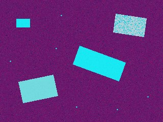 |

The result looks strange because the screen shows hue, saturation and value as if they were red,
green and blue. It is not meant to be looked at; it is meant to be fed to Threshold.

| Setting | Meaning                                                                             |
| ------- | ----------------------------------------------------------------------------------- |
| `to`    | `HSV` for most colour work. `YCrCb` and `Lab` are steadier under changing light for red and blue. `Gray` keeps only brightness. |

Hue runs from 0 to 179, not 0 to 255: red is near 0 and 179, yellow near 25, green near 60, blue
near 115.

### Channel

Takes one part of a picture on its own, as a grey picture in which bright means "a lot".

Here it is the saturation of the HSV picture. The coloured blocks are bright and the grey floor is
dark, whatever colour the blocks are.

| Before                    | After (saturation)               |
| ------------------------- | -------------------------------- |
|  | 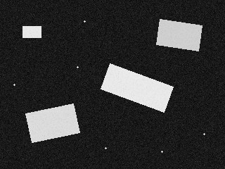 |

| Setting   | Meaning                                                                         |
| --------- | ------------------------------------------------------------------------------- |
| `channel` | Which part: 0, 1 or 2. The studio shows its name under the slider, such as Hue. |

### Threshold

Keeps the pixels whose colour is inside a range and throws the rest away. The result is a mask:
white where the colour matched, black elsewhere. This is the node that decides what counts as "the
thing I am looking for".

Here the range is yellow.

| Before                    | After                        |
| ------------------------- | ---------------------------- |
|  |  |

Both yellow blocks are found, and so are the specks. Morphology removes those.

| Setting | Meaning                                              |
| ------- | ---------------------------------------------------- |
| `min`   | The least value of each channel that is kept.        |
| `max`   | The greatest value of each channel that is kept.     |

The studio names each channel after what feeds the node: Hue, Saturation and Value after an HSV
ConvertColor; Red, Green and Blue straight from the camera.

Two things make it easier:

- **Pick from image.** Press it, then click the object in the preview. The range is set around
  the colour you clicked. Shift-click another part of the object to widen the range to include it.
- **Red wraps around.** Red sits at both ends of the hue scale. Set the hue `min` above the hue
  `max`, for example min 170 and max 10, and the range runs off the top and back in at the bottom.

## Filter

### Blur

Smooths a picture, so that noise and fine texture stop mattering.

| Before                       | After (size 15)            |
| ---------------------------- | -------------------------- |
|  | 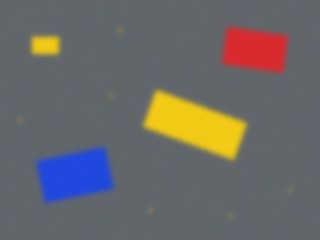 |

| Setting | Meaning                                                                              |
| ------- | ------------------------------------------------------------------------------------ |
| `kind`  | `gaussian` is the usual choice. `median` removes specks while keeping edges sharp. `box` is the fastest. |
| `size`  | How far the smoothing reaches, in pixels. Larger is smoother and slower.             |

### Canny

Finds edges: the places where brightness changes suddenly.

| Before (lightly blurred)     | After                       |
| ---------------------------- | --------------------------- |
| 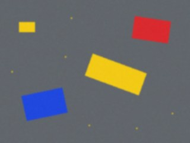 | 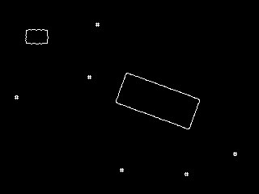 |

The red and blue blocks have no edges here. Canny looks at brightness only, and those blocks are
about as bright as the floor. To find an object by its colour, use Threshold instead.

Blur the picture a little first, or noise shows up as edges.

| Setting | Meaning                                                                          |
| ------- | -------------------------------------------------------------------------------- |
| `low`   | Changes weaker than this are never edges.                                        |
| `high`  | Changes stronger than this are always edges. In between, a change counts only if it joins a strong edge. |

### Region

Blacks out everything outside a rectangle, so that the rest of the pipeline looks only at the part
of the picture that matters. Use it to ignore the wall, the robot's own parts, or the other half of
the field.

| Before                       | After                        |
| ---------------------------- | ---------------------------- |
|  | 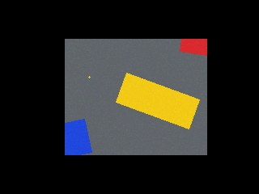 |

Positions stay those of the whole picture: an object at x 200 is still at x 200 afterwards. It
works on a mask as well as on an image.

| Setting           | Meaning                                                    |
| ----------------- | ---------------------------------------------------------- |
| `x`, `y`          | The top left corner, in percent of the picture.            |
| `width`, `height` | The size, in percent of the picture.                       |

## Mask

### Morphology

Tidies a mask by shrinking or growing its white areas.

Here `open` removes the specks and keeps the blocks.

| Before                       | After (open, size 5)        |
| ---------------------------- | --------------------------- |
|  | 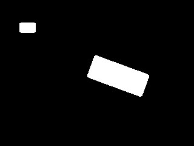 |

| Setting      | Meaning                                                                        |
| ------------ | ------------------------------------------------------------------------------ |
| `op`         | `open` removes small white specks. `close` fills small black holes. `erode` shrinks every white area. `dilate` grows every white area. |
| `size`       | The size of what is removed or filled, in pixels.                              |
| `iterations` | How many times to repeat it.                                                   |

### Combine

Joins two masks into one.

Here `or` joins the yellow mask and the blue mask, so that both colours are found by the nodes
that follow.

| First                        | Second                     | After (or)                 |
| ---------------------------- | -------------------------- | -------------------------- |
|  | 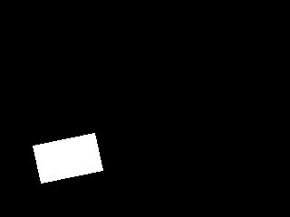 | 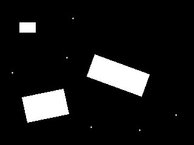 |

| Setting | Meaning                                                                               |
| ------- | ------------------------------------------------------------------------------------- |
| `op`    | `or`: white in either. `and`: white in both. `xor`: white in exactly one. `subtract`: white in the first but not the second. |

### Invert

Swaps black and white, so that the mask means "everything except".

| Before                      | After                          |
| --------------------------- | ------------------------------ |
|  | 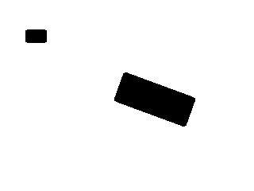 |

### ApplyMask

Shows the original picture only where a mask is white. It is useful for checking by eye what a
mask has kept.

| Image                        | Mask                        | After                     |
| ---------------------------- | --------------------------- | ------------------------- |
|  |  | 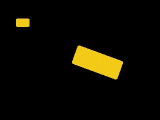 |

## Detect

### FindContours

Traces the outline of every white area of a mask. This turns "these pixels are white" into "here
are three separate objects".

The studio draws the outlines in green on the camera picture.

| Before                          | After                          |
| ------------------------------- | ------------------------------ |
|  | 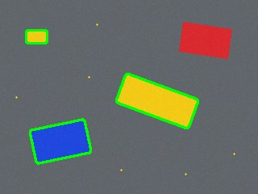 |

| Setting | Meaning                                                                             |
| ------- | ----------------------------------------------------------------------------------- |
| `mode`  | `outer` traces only the outside of each area. `all` also traces holes inside areas. |

### FilterContours

Keeps the outlines of the right size and shape and drops the rest.

Here a least area of 1000 drops the small yellow block.

| Before                         | After (minArea 1000)           |
| ------------------------------ | ------------------------------ |
|  |  |

| Setting                  | Meaning                                                           |
| ------------------------ | ----------------------------------------------------------------- |
| `minArea`, `maxArea`     | The size to keep, in square pixels.                               |
| `minAspect`, `maxAspect` | Width divided by height. A square is 1, a wide object more than 1, a tall one less than 1. |
| `minSolidity`            | How filled-in the shape is, in percent. A solid block is near 100; a ring or an L shape is much lower. |

A slider at the top of its range means "no limit".

### Largest

Keeps only the biggest outlines, biggest first. Use it when the nearest object is the one you
want, since nearer objects look bigger.

| Before                         | After (count 1)               |
| ------------------------------ | ----------------------------- |
|  | 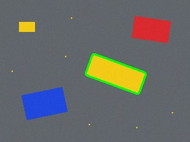 |

| Setting | Meaning            |
| ------- | ------------------ |
| `count` | How many to keep.  |

### Boxes

Puts a box around each outline and measures it. This is what robot code usually wants: where the
object is, how big it is and which way it is turned.

| Before                         | After (rotated)             |
| ------------------------------ | --------------------------- |
|  | 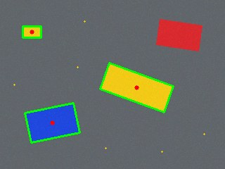 |

| Setting | Meaning                                                                               |
| ------- | ------------------------------------------------------------------------------------- |
| `kind`  | `upright` boxes have level sides. `rotated` boxes turn to fit the object as tightly as they can, and report its angle. |

Each box has an `x` and `y` (its centre), a `width`, a `height`, an `angle` in degrees and an
`area`, all in pixels of the camera picture, measured from the top left corner.

### Measure

Takes one number out of the first box: its `x`, `y`, `width`, `height`, `angle` or `area`. `count`
gives how many boxes there are instead.

It has no picture. The studio shows the number at the bottom of the node.

If there is no box, the number is "not a number" (`NaN`), except `count`, which is 0.

## Output

### Output

Gives robot code a value under a name. Nothing leaves the pipeline unless it goes through an
Output node.

| Setting | Meaning                                          |
| ------- | ------------------------------------------------ |
| `name`  | The name robot code reads the value by.          |

A number is read with `vision.number("name")`. Boxes are read with `vision.detection("name")` for
the first one, or `vision.detections("name")` for all of them. Contours or a mask connected to an
Output are turned into upright boxes.
